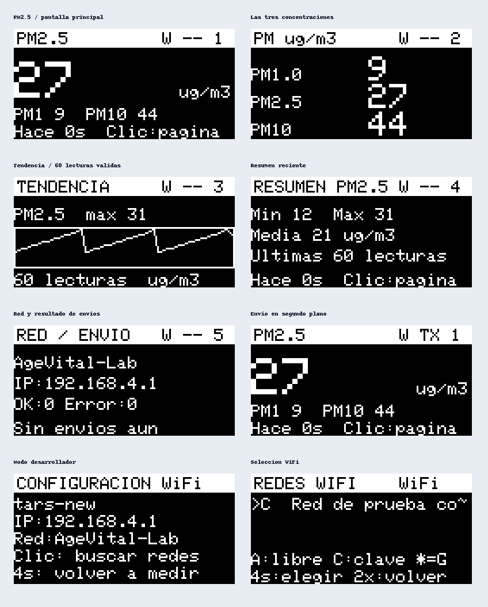

# TARS Air — Monitor de partículas ESP32

Firmware `air-2.0.1`, para OLED SSD1306 de 128×64 y DFRobot SEN0460. Las lecturas, el botón y la pantalla continúan funcionando durante los envíos HTTP y la renovación de token.

La adaptación parte de AirQualityMonitor `ad2e966729484bbfcd78002a9edf2e34b3f3933e` y toma el modo desarrollador de TARS legacy 1.1.1 (`cd431c317d2fc669f05a1d15c6a4492e21a24b9c`). Detalles y validación: [REVISION.md](REVISION.md).



## Pantalla y botón

| Página | Contenido |
|---|---|
| 1 | PM2.5 grande; PM1.0 y PM10 debajo; antigüedad de la lectura |
| 2 | Las tres concentraciones con cifras ampliadas |
| 3 | Tendencia de las últimas 60 lecturas válidas, escala automática |
| 4 | Mínimo, máximo y media de ese historial; independiente de los envíos |
| 5 | WiFi, IP, envíos correctos, errores y último resultado |

Las unidades son `ug/m3` (µg/m³). Se conservan los registros **STANDARD** utilizados por el código original; no se cambia silenciosamente la escala a ATMOSPHERE. Son concentraciones instantáneas, no un AQI oficial ni una media de exposición de 24 horas.

En el encabezado, `W` indica WiFi conectado, `-` desconectado, `TX` envío en curso, `OK` último envío confirmado, `!!` fallo y `--` ausencia de intentos. El número indica la página. `--` en un valor significa lectura ausente o inválida; un cero leído correctamente sigue siendo cero.

- Clic: siguiente página. Si la OLED está apagada, el primer clic sólo la despierta.
- Doble clic: volver a la página principal.
- Mantener 4 segundos: entrar o salir del modo desarrollador. Si hay un envío en curso, las lecturas continúan mientras se espera su resultado antes de abrir el panel.
- La OLED se apaga realmente tras el tiempo de inactividad configurado. Los envíos no la despiertan ni cambian la página.

## Modo desarrollador

Menú OLED y panel web local, sin integración AMERI ni comprobaciones periódicas contra servicios externos. El panel consulta `/status` en el propio ESP32 cada 3 segundos mientras está visible. Durante configuración se siguen leyendo los sensores y se pausa el envío; durante OTA se pausa también la lectura.

En el menú, clic busca redes de forma asíncrona. En la lista: clic avanza, mantener 4 segundos selecciona y doble clic vuelve. Se muestran tres filas; `A` es abierta, `C` protegida y `*` guardada. Se recuerdan tres redes y se recuperan las credenciales del firmware anterior. Una red protegida sin clave guardada abre el AP con el SSID ya elegido en el formulario. La selección tiene timeout de 12 s y permite cancelar con doble clic.

Si no hay conexión se crea `TARS-<hostname>` (máximo 32 caracteres), clave `12345678`, en `192.168.4.1`. Con conexión, se accede mediante la IP mostrada o `<hostname>.local`. El panel permite configurar WiFi, intervalos, destino y Keyrock; identificar la OLED, volver a medir y cargar firmware `.bin`. Los secretos no se rellenan en el HTML. El modo POST al agente existente es opcional; por defecto se mantiene PATCH directo a Orion.

El panel/OTA local conserva el acceso sin autenticación de la base legacy y HTTPS conserva `setInsecure()`; la validación de certificados y el control de acceso no forman parte de esta revisión.

## Binario listo para OTA

[Descargar air-2.0.1 para ESP32-WROOM-DA](https://raw.githubusercontent.com/1cfer/AirQualityMonitor/main/firmware/AirQualityMonitor_air-2.0.1_ESP32DA.bin) · [Instrucciones y SHA-256](firmware/README.md)

Binario de aplicación para el panel OTA, compilado para `esp32:esp32:esp32da` y una partición de 1.310.720 bytes. Para otra placa o partición, compilar el sketch con su configuración.

## Instalación

1. Instalar el núcleo ESP32 y las bibliotecas ArduinoJson 7, Adafruit SSD1306, Adafruit GFX y Adafruit BusIO.
2. Abrir `AIRQ/AIRQ.ino` conservando todos los archivos de la carpeta.
3. Elegir la placa ESP32 correspondiente y cargar por USB. La compilación de referencia usa `esp32:esp32:esp32da`, núcleo 3.3.12.
4. Configurar el equipo desde el AP en el primer arranque, o mantener 4 s para empezar a medir sin WiFi.

No hace falta instalar DFRobot_AirQualitySensor: el pequeño lector I2C incluido comprueba los bytes recibidos y utiliza los registros documentados por [DFRobot](https://github.com/DFRobot/DFRobot_AirQualitySensor).

| Hardware | Conexión conservada |
|---|---|
| SSD1306 128×64 | I2C 0x3C o 0x3D, SDA21/SCL22 |
| SEN0460 | I2C 0x19, SDA21/SCL22 |
| Botón | GPIO27 a GND, pull-up interno |

## Arquitectura

`loop()` conserva la propiedad de I2C, pantalla, botón, configuración y acumuladores. Una única tarea FreeRTOS realiza OAuth y HTTP con una instantánea de configuración y de las muestras. Las colas devuelven sólo el resultado. Si el servidor confirma con 2xx se descarta el lote enviado; si falla, se integra de nuevo con las muestras tomadas durante la petición. Se limita a una petición en curso. Los fallos se reintentan al intervalo configurado, contado desde el final de la petición.

Los datos pendientes se guardan en RAM y se pierden al reiniciar. Tras acumulaciones muy prolongadas se reduce el peso de las muestras para mantener los enteros acotados: no es una cola histórica persistente. El historial gráfico mantiene las últimas 60 muestras válidas.

## Verificación reproducible

En Windows con MSVC y las bibliotecas anteriores instaladas:

```bat
tests\run-native.cmd
python tests\render_oled.py
arduino-cli compile --fqbn esp32:esp32:esp32da --warnings all AIRQ
```

Las pruebas ejecutan los archivos C++ de producción con I2C, OLED y HTTP simulados, ArduinoJson real y un hilo de red real en el entorno nativo. Comprobar en hardware: OLED, sensor, botón, WiFi, destino real y OTA antes de usar el firmware en campo.

MIT. Proyecto original de [1cfer](https://github.com/1cfer), Universidad Pontificia Bolivariana / Semillero AgeVital.
